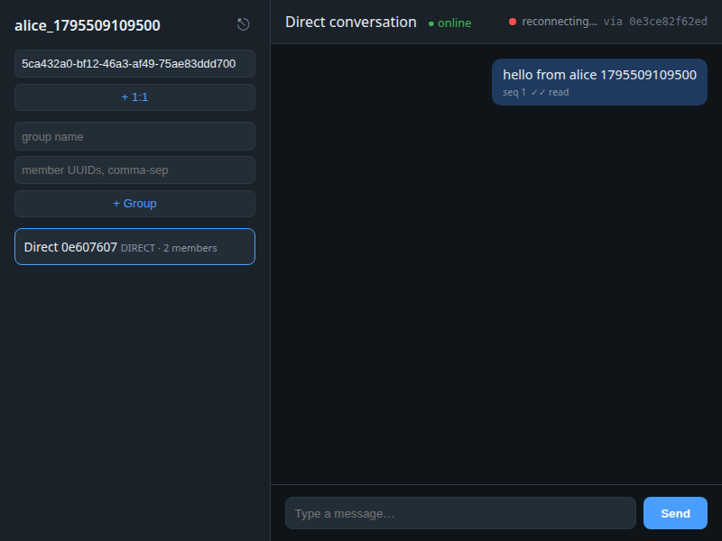

# Relay — Distributed Real-Time Chat

A scalable, distributed chat backend built as a **microservices showcase**: Java 21, Spring Boot 3.5,
Spring Cloud Gateway, Eureka, Kafka, Redis, and PostgreSQL-per-service. Users connected to
**different chat-service instances** can message each other in real time through a single gateway.

> Positioning: this repo tells a *"partitioned durable log + CQRS read model + database-per-service"*
> story. See [`docs/architecture.md`](docs/architecture.md) for the full Phase-1 proposal and
> [`docs/adr/`](docs/adr/) for decision records.



---

## Architecture

In-depth, paste-ready Mermaid (components, data stores, Kafka topics, flows) plus a cross-instance
message sequence diagram live in [`docs/architecture-diagram.md`](docs/architecture-diagram.md).

```mermaid
flowchart TB
  subgraph CLIENTS["Clients"]
    TAB1["Browser tab — Alice<br/>vanilla JS STOMP client"]
    TAB2["Browser tab — Bob<br/>vanilla JS STOMP client"]
    K6["k6 load generator<br/>STOMP over k6/ws"]
  end

  subgraph EDGE["Edge layer"]
    FE["frontend · nginx:alpine<br/>static HTML/JS · :18088"]
    subgraph GW["Spring Cloud Gateway (reactive) · :18080"]
      JWT["JWT validation<br/>HS256 · forwards X-User-Id"]
      RL["RequestRateLimiter<br/>Redis bucket per user"]
      CORS["CORS (single layer)"]
      CB["Resilience4j circuit breakers<br/>+ 503 fallback"]
      RT["Routes lb:// · lb:ws://<br/>+ Swagger aggregation"]
    end
  end

  subgraph DISC["Discovery"]
    EUREKA["Eureka server · :18761"]
  end

  subgraph AUTH["auth-service · :8081"]
    A_CTRL["AuthController<br/>register / login / refresh / logout"]
    A_TOK["TokenService<br/>HS256 access + rotating refresh"]
    A_SEC["Spring Security · BCrypt"]
  end

  subgraph CHAT["chat-service ×2 · :8082"]
    C_WS["STOMP /ws endpoint<br/>JWT CONNECT auth"]
    C_REG["SessionRegistry<br/>local userId → session"]
    C_HND["Handlers<br/>send / typing / receipt"]
    C_CONV["ConversationService<br/>1:1 / group / members"]
    C_OUT["Outbox poller<br/>SKIP LOCKED"]
    C_FAN["FanoutConsumer<br/>per-instance group"]
    C_RL["Redis Lua rate limit"]
    C_HB["Presence heartbeat 10s"]
    C_AUTH["AuthClient<br/>RestClient + retry + CB"]
  end

  subgraph HIST["history-service · :8083"]
    H_CMD["CommandConsumer<br/>group history · 1 writer/partition"]
    H_ING["Ingest: dedup + atomic seq<br/>UPDATE…RETURNING"]
    H_OUT["Outbox poller<br/>SKIP LOCKED"]
    H_PROJ["Membership projection"]
    H_RCPT["Receipt watermarks<br/>GREATEST upsert"]
    H_Q["Query API<br/>keyset pagination / gap-sync"]
  end

  subgraph PRES["presence-service · :8084"]
    P_CON["PresenceConsumer"]
    P_Q["Presence REST"]
  end

  subgraph KAFKA["Kafka (KRaft) · partition key = conversationId"]
    T_CMD[/"chat.message.command"/]
    T_PER[/"chat.message.persisted"/]
    T_CONV[/"chat.conversation.events"/]
    T_PC[/"chat.presence.connection"/]
    T_PCH[/"chat.presence.changed"/]
    T_TYP[/"chat.typing"/]
    T_REC[/"chat.receipt"/]
    T_DLT[/"*.DLT (dead letter)"/]
  end

  subgraph REDIS["Redis"]
    R_PRES["presence:{userId} · TTL 30s"]
    R_RL["rate-limit buckets"]
  end

  subgraph PG["PostgreSQL · database per service"]
    PG_A[("authdb<br/>users · refresh_tokens")]
    PG_C[("chatdb<br/>conversations · members · outbox")]
    PG_H[("historydb<br/>messages (hash-partitioned)<br/>state · projection · read_state · outbox")]
  end

  subgraph OBS["Observability"]
    PROM["Prometheus<br/>Docker SD · remote-write receiver"]
    GRAF["Grafana<br/>overview + k6 dashboards"]
    ZIP["Zipkin traces"]
  end

  TAB1 -->|"https :18088"| FE
  TAB2 --> FE
  TAB1 -->|"REST + wss :18080"| GW
  TAB2 --> GW
  K6 -->|"REST + ws"| GW

  JWT --> RL --> CORS --> CB --> RT
  RT -->|"lb://"| AUTH
  RT -->|"lb:ws://"| CHAT
  RT -->|"lb://"| HIST
  RT -->|"lb://"| PRES
  RL --- R_RL
  GW -.->|register / discover| EUREKA
  AUTH -.-> EUREKA
  CHAT -.-> EUREKA
  HIST -.-> EUREKA
  PRES -.-> EUREKA

  A_CTRL --> A_TOK --> A_SEC
  AUTH --- PG_A

  C_WS --> C_REG
  C_WS --> C_HND
  C_HND --> C_RL
  C_RL --- R_RL
  C_HND -->|produce| T_CMD
  C_HND -->|typing| T_TYP
  C_HND -->|receipt| T_REC
  C_CONV --- PG_C
  C_CONV -->|outbox| C_OUT
  C_OUT -->|produce| T_CONV
  C_AUTH -->|"GET /internal/users"| AUTH
  C_HB -->|heartbeat| T_PC
  C_WS -->|connect / disconnect| T_PC

  T_PER -->|broadcast group| C_FAN
  T_CONV --> C_FAN
  T_TYP --> C_FAN
  T_REC --> C_FAN
  T_PCH --> C_FAN
  C_FAN -->|push to local sessions| C_REG
  C_FAN -->|DELIVERED receipt| T_REC
  C_REG -->|STOMP MESSAGE| TAB1
  C_REG --> TAB2

  T_CMD -->|group history| H_CMD --> H_ING
  H_ING --- PG_H
  H_ING -->|outbox| H_OUT -->|produce| T_PER
  T_CONV -->|projection| H_PROJ --- PG_H
  T_REC -->|watermarks| H_RCPT --- PG_H
  H_Q --- PG_H
  RT -->|"offline sync GET"| H_Q

  T_PC --> P_CON
  P_CON --- R_PRES
  P_CON -->|transition| T_PCH
  P_Q --- R_PRES

  H_CMD -.->|poison after backoff| T_DLT
  C_FAN -.-> T_DLT

  AUTH -.->|metrics / traces| PROM
  CHAT -.-> PROM
  HIST -.-> PROM
  PRES -.-> PROM
  K6 -.->|remote write| PROM
  PROM --> GRAF
  AUTH -.-> ZIP
  CHAT -.-> ZIP
  HIST -.-> ZIP
```



### Services & data ownership

| Service | Responsibility | Owned data |
|---|---|---|
| **gateway** | Single entry point: JWT validation, per-user rate limiting, CORS, circuit breakers, load balancing | — (Redis for rate limits) |
| **auth-service** | Register/login, HS256 JWT access + rotating refresh tokens, BCrypt | `authdb`: users, refresh_tokens |
| **chat-service** (×2) | STOMP/WebSocket relay, conversation aggregate, send path, broadcast fan-out, typing/receipts | `chatdb`: conversations, members, outbox |
| **history-service** | Message system of record: dedup, per-conversation seq, outbox, cursor pagination, offline sync, read watermarks | `historydb`: messages (partitioned), state, projections, outbox |
| **presence-service** | Online/offline with Redis TTL, presence transitions | Redis |
| **discovery-server** | Eureka service registry | — |

No shared tables. Inter-service communication is **async via Kafka**, with exactly one synchronous
call (chat → auth on invite) wrapped in timeout + retry + circuit breaker.

---

## Quick start

Requires Docker + Compose. One command brings up the whole stack:

```bash
docker compose up -d --build
```

| Component | URL |
|---|---|
| **Frontend demo** | http://localhost:18088 |
| Gateway (API + WS) | http://localhost:18080 |
| **Swagger UI (aggregated)** | http://localhost:18080/swagger-ui.html |
| Eureka | http://localhost:18761 |
| Grafana (admin/admin) | http://localhost:13000 |
| Prometheus | http://localhost:19090 |
| Zipkin | http://localhost:19411 |
| PostgreSQL | localhost:15432 (auth), 15433 (chat), 15434 (history) |
| Redis / Kafka | localhost:16379 / localhost:19092 |

### Demo: two tabs, two instances

1. Open http://localhost:18088 in **two browser tabs** (or two browsers).
2. Register `alice` in one and `bob` in the other.
3. In alice's tab, paste bob's user UUID (shown in the sidebar/`/users/me`) and click **+ 1:1**.
4. Send messages both ways. The gateway load-balances the two WebSocket connections across
   `chat-service` replicas; the header shows which instance serves each tab. Messages, typing,
   presence, and read receipts flow across instances via Kafka.

> The broadcast fan-out means it works whether the tabs land on the same or different instances.

---

## API docs

OpenAPI is generated per service (springdoc) and **aggregated at the gateway**:
http://localhost:18080/swagger-ui.html (select a service from the dropdown).

Key endpoints (all through the gateway; `Authorization: Bearer <access>` unless noted):

| Method | Path | Purpose |
|---|---|---|
| POST | `/auth/register`, `/auth/login`, `/auth/refresh`, `/auth/logout` | Auth (public) |
| GET | `/users/me` | Current user |
| POST | `/conversations/direct`, `/conversations/group` | Create chat |
| POST/DELETE | `/conversations/{id}/members[/{userId}]` | Manage members |
| GET | `/conversations` | List my conversations |
| GET | `/history/conversations/{id}/messages?afterSeq&limit` | Cursor pagination / offline sync |
| GET | `/history/conversations/{id}/state` | Read/delivered watermarks |
| GET | `/presence/{userId}`, `/presence?ids=` | Presence |
| WS | `/ws?access_token=<jwt>` | STOMP: `/app/chat.send`, `/app/chat.typing`, `/app/chat.receipt`; subscribe `/user/queue/*` |

---

## Design decisions & trade-offs

Study-friendly summary: [`docs/architectural-decisions.md`](docs/architectural-decisions.md).
Full records in [`docs/adr/`](docs/adr/). Highlights:

- **Kafka over Redis Pub/Sub** — per-conversation ordering (partition key), replay for offline sync,
  native DLQ + consumer lag. Redis stays for presence/rate-limits (ephemeral jobs).
- **Persist-before-fanout** — a message fans out only after history assigns a real sequence number
  via a transactional outbox. Costs one broker hop; guarantees ordering + durability before "delivered".
- **Broadcast consumer groups** — each chat instance is its own consumer group and delivers only to
  local sessions. Stateless alternative to sticky routing; any instance serves any user.
- **Idempotency + ordering** — client-generated message ID deduped with `ON CONFLICT`; seq assigned by
  atomic `UPDATE … RETURNING`; single writer per conversation partition.
- **CQRS read model** — history is a derived, eventually-consistent read store; membership projection
  authorizes reads without a sync RPC per page.
- **Watermark receipts** — conversation-level `last_read/delivered_seq` instead of per-message status
  rows (avoids write fan-out storms in groups).
- **HS256 shared-secret JWT** in one trust domain (RS256/JWKS is the evolution); CORS + JWT at the edge only.
- **Resilience** — transactional outbox + `SKIP LOCKED` poller, Kafka DLQ with backoff, Resilience4j
  circuit breaker + retry on the one sync call, Redis rate limiting (fail-open).

### Known limitations

- Single Kafka broker (RF=1) and single Postgres per service locally; single gateway locally
  (multi-gateway HA is prod topology behind a cloud LB).
- HS256 shared secret; dev secret in Compose (override in prod).
- Membership projection is eventually consistent; one presence mapping per user; text-only messages.

### Future improvements

Sharding / conversation→instance affinity for fan-out; Kafka RF=3 + Postgres read replicas;
RS256 + JWKS rotation; Kubernetes with Spring Cloud Kubernetes discovery; media via object storage;
E2E encryption; multi-region with MirrorMaker2; strict membership revocation.

---

## Observability

- **Grafana** dashboard "Relay — Distributed Chat Overview" (provisioned): active WS connections per
  instance, message throughput, e2e delivery latency percentiles, Kafka broker lag, rate-limit
  rejections, outbox pending, JVM heap/CPU per service.
- **Prometheus** scrapes every replica via Docker service discovery.
- **Zipkin** distributed tracing (Micrometer Tracing), correlation IDs across REST + Kafka.

## Testing

```bash
./mvnw verify   # or: mvn verify
```

Unit tests + Testcontainers (Postgres) integration tests + an `@EmbeddedKafka` DLQ test.
Phase gates were verified with real measured runs (see ADRs for evidence).

## Load testing

A [k6](https://k6.io) load test (`loadtest/relay-load.js`) drives real STOMP-over-WebSocket traffic
through the gateway (register-once-per-VU, send→echo delivery latency). Metrics stream to Prometheus
via remote write and render on the Grafana dashboard **"Relay — k6 Load Test"**.

```bash
K6_PROMETHEUS_RW_SERVER_URL=http://localhost:19090/api/v1/write \
K6_PROMETHEUS_RW_TREND_STATS="avg,med,p(95),p(99),max" \
  k6 run --out experimental-prometheus-rw loadtest/relay-load.js
```

Measured at 150 VUs on a single shared host: delivery **p95 ≈ 229 ms, p99 ≈ 243 ms**, **0% WS errors**,
0% HTTP failures (thresholds: p95 < 2 s, errors < 5%). See [`loadtest/RESULTS.md`](loadtest/RESULTS.md)
for the full numbers and honesty notes.

## Project layout

```
relay-parent/            multi-module Maven reactor
  chat-events/           shared event schemas (records) — no business logic
  discovery-server/      Eureka
  gateway/               Spring Cloud Gateway (reactive)
  auth-service/          auth/user
  chat-service/          real-time relay + conversations
  history-service/       message store + read model
  presence-service/      presence
frontend/                vanilla HTML/JS client (no build step)
ops/                     db init SQL, kafka topics, prometheus, grafana, nginx
docs/                    architecture, ADRs, interview prep, demo screenshot
```

See [`docs/interview-prep.md`](docs/interview-prep.md) for a 2-minute pitch and likely follow-up questions.
