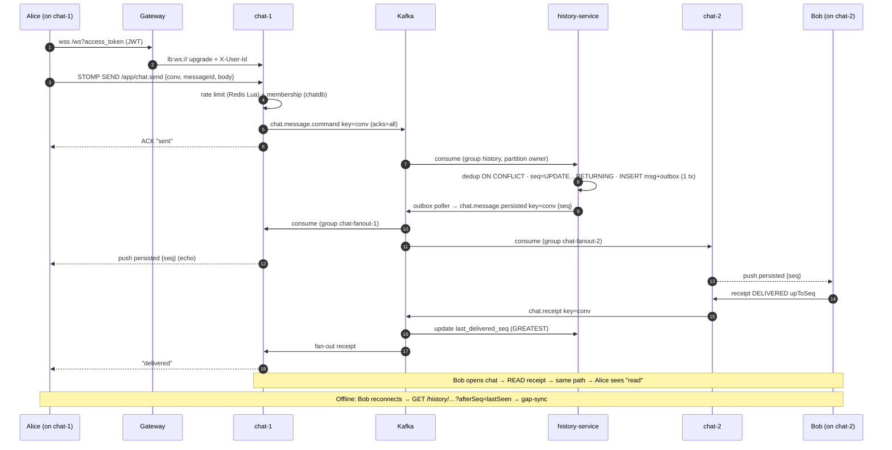

# Relay — in-depth architecture diagrams

Paste either block into [mermaid.live](https://mermaid.live) to render/edit.

## 1. Full architecture (components, data stores, topics, flows)

```mermaid
flowchart TB
  subgraph CLIENTS["Clients"]
    TAB1["Browser tab — Alice<br/>vanilla JS STOMP client"]
    TAB2["Browser tab — Bob<br/>vanilla JS STOMP client"]
    K6["k6 load generator<br/>STOMP over k6/ws"]
  end

  subgraph EDGE["Edge layer"]
    FE["frontend · nginx:alpine<br/>static HTML/JS · :18088"]
    subgraph GW["Spring Cloud Gateway (reactive) · :18080"]
      JWT["JWT validation<br/>HS256 · forwards X-User-Id"]
      RL["RequestRateLimiter<br/>Redis bucket per user"]
      CORS["CORS (single layer)"]
      CB["Resilience4j circuit breakers<br/>+ 503 fallback"]
      RT["Routes lb:// · lb:ws://<br/>+ Swagger aggregation"]
    end
  end

  subgraph DISC["Discovery"]
    EUREKA["Eureka server · :18761"]
  end

  subgraph AUTH["auth-service · :8081"]
    A_CTRL["AuthController<br/>register / login / refresh / logout"]
    A_TOK["TokenService<br/>HS256 access + rotating refresh"]
    A_SEC["Spring Security · BCrypt"]
  end

  subgraph CHAT["chat-service ×2 · :8082"]
    C_WS["STOMP /ws endpoint<br/>JWT CONNECT auth"]
    C_REG["SessionRegistry<br/>local userId → session"]
    C_HND["Handlers<br/>send / typing / receipt"]
    C_CONV["ConversationService<br/>1:1 / group / members"]
    C_OUT["Outbox poller<br/>SKIP LOCKED"]
    C_FAN["FanoutConsumer<br/>per-instance group"]
    C_RL["Redis Lua rate limit"]
    C_HB["Presence heartbeat 10s"]
    C_AUTH["AuthClient<br/>RestClient + retry + CB"]
  end

  subgraph HIST["history-service · :8083"]
    H_CMD["CommandConsumer<br/>group history · 1 writer/partition"]
    H_ING["Ingest: dedup + atomic seq<br/>UPDATE…RETURNING"]
    H_OUT["Outbox poller<br/>SKIP LOCKED"]
    H_PROJ["Membership projection"]
    H_RCPT["Receipt watermarks<br/>GREATEST upsert"]
    H_Q["Query API<br/>keyset pagination / gap-sync"]
  end

  subgraph PRES["presence-service · :8084"]
    P_CON["PresenceConsumer"]
    P_Q["Presence REST"]
  end

  subgraph KAFKA["Kafka (KRaft) · partition key = conversationId"]
    T_CMD[/"chat.message.command"/]
    T_PER[/"chat.message.persisted"/]
    T_CONV[/"chat.conversation.events"/]
    T_PC[/"chat.presence.connection"/]
    T_PCH[/"chat.presence.changed"/]
    T_TYP[/"chat.typing"/]
    T_REC[/"chat.receipt"/]
    T_DLT[/"*.DLT (dead letter)"/]
  end

  subgraph REDIS["Redis"]
    R_PRES["presence:{userId} · TTL 30s"]
    R_RL["rate-limit buckets"]
  end

  subgraph PG["PostgreSQL · database per service"]
    PG_A[("authdb<br/>users · refresh_tokens")]
    PG_C[("chatdb<br/>conversations · members · outbox")]
    PG_H[("historydb<br/>messages (hash-partitioned)<br/>state · projection · read_state · outbox")]
  end

  subgraph OBS["Observability"]
    PROM["Prometheus<br/>Docker SD · remote-write receiver"]
    GRAF["Grafana<br/>overview + k6 dashboards"]
    ZIP["Zipkin traces"]
  end

  TAB1 -->|"https :18088"| FE
  TAB2 --> FE
  TAB1 -->|"REST + wss :18080"| GW
  TAB2 --> GW
  K6 -->|"REST + ws"| GW

  JWT --> RL --> CORS --> CB --> RT
  RT -->|"lb://"| AUTH
  RT -->|"lb:ws://"| CHAT
  RT -->|"lb://"| HIST
  RT -->|"lb://"| PRES
  RL --- R_RL
  GW -.->|register / discover| EUREKA
  AUTH -.-> EUREKA
  CHAT -.-> EUREKA
  HIST -.-> EUREKA
  PRES -.-> EUREKA

  A_CTRL --> A_TOK --> A_SEC
  AUTH --- PG_A

  C_WS --> C_REG
  C_WS --> C_HND
  C_HND --> C_RL
  C_RL --- R_RL
  C_HND -->|produce| T_CMD
  C_HND -->|typing| T_TYP
  C_HND -->|receipt| T_REC
  C_CONV --- PG_C
  C_CONV -->|outbox| C_OUT
  C_OUT -->|produce| T_CONV
  C_AUTH -->|"GET /internal/users"| AUTH
  C_HB -->|heartbeat| T_PC
  C_WS -->|connect / disconnect| T_PC

  T_PER -->|broadcast group| C_FAN
  T_CONV --> C_FAN
  T_TYP --> C_FAN
  T_REC --> C_FAN
  T_PCH --> C_FAN
  C_FAN -->|push to local sessions| C_REG
  C_FAN -->|DELIVERED receipt| T_REC
  C_REG -->|STOMP MESSAGE| TAB1
  C_REG --> TAB2

  T_CMD -->|group history| H_CMD --> H_ING
  H_ING --- PG_H
  H_ING -->|outbox| H_OUT -->|produce| T_PER
  T_CONV -->|projection| H_PROJ --- PG_H
  T_REC -->|watermarks| H_RCPT --- PG_H
  H_Q --- PG_H
  RT -->|"offline sync GET"| H_Q

  T_PC --> P_CON
  P_CON --- R_PRES
  P_CON -->|transition| T_PCH
  P_Q --- R_PRES

  H_CMD -.->|poison after backoff| T_DLT
  C_FAN -.-> T_DLT

  AUTH -.->|metrics / traces| PROM
  CHAT -.-> PROM
  HIST -.-> PROM
  PRES -.-> PROM
  K6 -.->|remote write| PROM
  PROM --> GRAF
  AUTH -.-> ZIP
  CHAT -.-> ZIP
  HIST -.-> ZIP
```

## 2. Cross-instance message path (send → persist → fan-out → receipts)

## Reading the diagram

- **Ownership**: each service writes only its own store/topic. chat owns conversations (chatdb);
  history owns messages (historydb); auth owns users (authdb); presence owns Redis presence keys.
- **Persist-before-fanout**: a message reaches recipients only after history assigns a real seq and
  the outbox publishes `chat.message.persisted`.
- **Broadcast fan-out**: every chat instance has its own consumer group, so all instances see every
  persisted event and deliver only to local sessions — no sticky sessions.
- **One sync call**: chat → auth `/internal/users/{id}` on invite, wrapped in retry + circuit breaker.
- **Observability**: Prometheus scrapes every replica (Docker SD) and receives k6 remote-write;
  Grafana renders overview + k6 dashboards; Zipkin collects traces.
