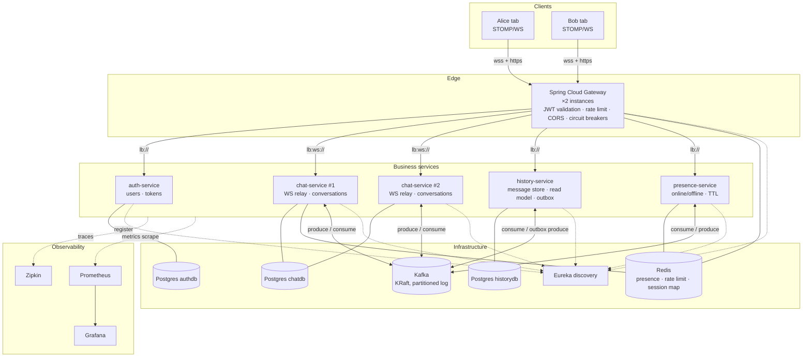

# Phase 1 — Architecture Proposal

**Project:** Distributed real-time chat (Java 21, Spring Boot 3.x, Spring Cloud)
**Positioning:** A microservices showcase demonstrating service boundaries, ordered event fan-out, the outbox pattern, and edge-gateway concerns. Deliberately distinct from the UPLINK repo (`~/Projects/realtime-chat`), which tells a "single stateful service scaled horizontally + Redis Pub/Sub fan-out" story. This repo tells a "partitioned durable log + CQRS read model + database-per-service" story.

**Status:** Proposal — pending confirmation. Items marked **[PROPOSED CUT]** deviate from the pinned spec and need explicit approval.

---

## 1. Assumptions (stated, not asked)

| # | Assumption | Rationale |
|---|-----------|-----------|
| A1 | New standalone repo at `~/java`; UPLINK is complete and untouched. | Different directory, different spec, different architectural story. |
| A2 | One active WebSocket session per user for presence purposes; broadcast fan-out still delivers to every open tab. | Keeps presence mapping simple; multi-device presence is a documented future item. |
| A3 | Text messages only, ≤ 4 KB body. Group size capped at 256 members. | Bounds fan-out and storage; media is a future item. |
| A4 | Single Kafka broker (KRaft, RF=1) and single Postgres per service locally; prod topology noted but not built. | One `docker compose up`; RF=3/replicas are config changes, not design changes. |
| A5 | HS256 self-issued JWT with a shared secret via env (same trust domain). RS256/JWKS is the evolution. | Boring, validated in UPLINK; avoids a JWKS endpoint + key-rotation machinery for a showcase. |
| A6 | Modern browsers only → STOMP over native WebSocket, no SockJS fallback. | SockJS exists for legacy networks; it adds gateway routing complexity for zero demo benefit. |
| A7 | English-only, no i18n, no email/push delivery. Offline delivery = history sync on reconnect. | No functional requirement consumes a notification channel. |

---

## 2. Component diagram



**Why this shape:** The gateway is the only public entry point (JWT validation, rate limiting, CORS, circuit breakers happen once, at the edge). Business services are stateless and register with Eureka so the gateway can load-balance with `lb://` URIs. All shared state lives in Kafka (durable log), Redis (ephemeral), or a per-service Postgres (durable truth). No service reads another service's database.

---

## 3. Service inventory

Four business services + gateway + discovery. Each exists for a reason that survives the "why not fold it into its neighbor?" interview question.

### 3.1 auth-service
- **Responsibility:** Register, login, JWT access + refresh token issuance/rotation, user profile lookup, password hashing (BCrypt).
- **Owned data:** `authdb` — `users`, `refresh_tokens`.
- **Why separate:** Security boundary. Credentials and token-signing keys live in exactly one place; the signing secret is distributed to validators via env, but the *issuer* is singular. Login is CPU-bound (BCrypt) and scales independently of WebSocket connection count.
- **Sync API exposed:** `GET /internal/users/{id}` (existence/profile) — consumed by chat-service on group invite, with timeout + retry + circuit breaker.

### 3.2 chat-service (run ×2+ instances)
- **Responsibility:** Terminate STOMP/WebSocket; authenticate CONNECT; maintain a **local** in-memory session registry; validate membership and rate-limit sends; publish message commands to Kafka; consume persisted events and fan out to local sockets; emit typing, delivery/read receipts, and connection events; own conversation metadata (create group, add/remove members, find-or-create 1:1).
- **Owned data:** `chatdb` — `conversations`, `conversation_members`, `outbox` (for conversation/membership events).
- **Why separate:** This is the stateful real-time edge. It owns the conversation aggregate because *every send needs a membership check at line rate* — a local indexed lookup beats a synchronous RPC per message. It holds **no messages**: durability and ordering belong to history-service.
- **Stateless?** Yes, across instances. The session registry is instance-local (a TCP socket is inherently pinned); all *shared* state is in Redis/Kafka/Postgres. Any instance can serve any user.

### 3.3 history-service
- **Responsibility:** System of record for messages. Consume message commands, dedup by client message ID, assign per-conversation sequence numbers atomically, persist message + outbox row in one transaction; poll outbox → publish persisted events. Serve cursor-paginated history and offline gap sync. Maintain a membership projection (from conversation events) for read authorization. Track delivered/read watermarks.
- **Owned data:** `historydb` — `messages` (partitioned), `conversation_state` (seq counter), `membership_projection`, `read_state`, `outbox`.
- **Why separate:** Read path vs write path (CQRS). The write path (chat) needs low-latency membership checks and fan-out; the read path needs durable ordering, flexible pagination, and replay. Separating them lets reads scale independently and lets us rebuild the read model from the log. It is also the single writer per conversation partition, which is what makes ordering provable.
- **Why not just read from chat's DB?** Database-per-service is pinned; more importantly, the read model is *derived* — it can lag by milliseconds, be rebuilt from Kafka, and use a different index/partition layout than the write side.

### 3.4 presence-service
- **Responsibility:** Consume connection events, maintain Redis presence keys with TTL, publish online/offline transitions, serve presence queries.
- **Owned data:** Redis only — `presence:{userId} → {instanceId, connectedAt}` (TTL ~30 s, refreshed by heartbeat). No Postgres.
- **Why separate:** Presence is ephemeral, TTL-based, AP-flavored state with a different consistency profile than messages. Owning it in one service keeps chat instances stateless and gives the frontend a presence API that doesn't touch the message path. Redis *is* its database (database-per-service satisfied by an owned store, not necessarily a relational one).

### 3.5 [PROPOSED CUT] notification-service
The spec lists it as an example, not a pinned requirement. No functional requirement consumes push/email: offline delivery is handled by history sync on reconnect (§7, step 8). **Recommend cutting.** Adding a service that nothing calls is over-splitting — the exact thing the spec warns against. If push notifications become a requirement later, it earns its place then.

### 3.6 Infrastructure
- **Spring Cloud Gateway (×2):** Single entry point. JWT validation filter, Redis `RequestRateLimiter` (key = user ID from JWT), CORS, Resilience4j circuit breakers on sync routes, `lb://` / `lb:ws://` load balancing via Eureka.
- **Eureka:** Service discovery. Chosen over Docker DNS because the spec's Phase 2 expects a discovery server and because Eureka gives dynamic registration + health-aware client-side LB — the canonical Spring Cloud pattern. Chosen over Spring Cloud Kubernetes because we deploy with Compose, not K8s. (Docker DNS would work for static Compose, but doesn't demonstrate the Spring Cloud LB story.)
- **Config:** Environment variables + Spring profiles (`local`, `docker`, `prod`). **Not** Spring Cloud Config server — one less bootstrap dependency and failure mode for zero benefit at this scale (12-factor).

---

## 4. Technology decisions & trade-offs

Each decision is 2–3 lines of "why", as the spec requires.

### 4.1 Broker: Kafka (over Redis Pub/Sub)
| | Kafka | Redis Pub/Sub |
|---|---|---|
| Ordering | Partition key = conversationId → per-conversation total order | No ordering guarantee across subscribers |
| Replay | Durable log; offline sync + read-model rebuild | Fire-and-forget; gone if you're not listening |
| Consumer groups / DLQ / lag | Native | Must build yourself |
| Ops weight | Heavier (KRaft broker) | Lighter (already running Redis) |
| Latency | ~ms (two hops in our flow) | Sub-ms |

**Pick Kafka.** Half the pinned requirements — per-conversation ordering, DLQ, broker-lag metrics, outbox, offline replay — are native Kafka features and would need bespoke machinery on Redis Pub/Sub. The latency cost is acceptable for chat at showcase scale. This also keeps the repo's story distinct from UPLINK (which chose Redis fan-out for the opposite trade-off). Redis stays for presence, rate limiting, and session mapping — the ephemeral jobs it's best at.

### 4.2 Message store: PostgreSQL, hash-partitioned (over MongoDB / Cassandra)
**Pick Postgres.** We already run it per service; one engine to explain. Cursor pagination is a keyset scan on `(conversation_id, seq)` — indexed, O(log n), stable under inserts. `PARTITION BY HASH (conversation_id)` (8 partitions) keeps a conversation in one partition and demonstrates the scaling story. Cassandra's wide-partition model is the "real" chat store at massive scale, but its consistency tuning, repair, and lack of ad-hoc queries are too much to defend in 45 minutes. MongoDB's flexible schema buys nothing — messages are rigid. Evolution path: range-partition by time for cold-data detach, then shard.

### 4.3 Transport: STOMP over native WebSocket (over raw WS)
**Pick STOMP.** Spring's `@MessageMapping` / `SimpMessagingTemplate` give destination semantics (`/topic/conversation.{id}`), a CONNECT frame we can authenticate, and heartbeats for free. Raw WS means hand-rolling framing, routing, and auth — more code to defend, no benefit. No SockJS (A6): modern browsers all speak WS; the fallback adds gateway routing complexity for nothing.

### 4.4 Ordering & idempotency
- **Ordering:** Kafka partition key = `conversationId` on both the command and persisted topics → one partition → one consumer instance in the history group → serial processing. Sequence numbers assigned atomically via `UPDATE conversation_state SET last_seq = last_seq + 1 RETURNING last_seq` (validated in UPLINK). Clients render by `seq` and resync on gaps.
- **Idempotency:** Client-generated `messageId` (UUID). History inserts with `ON CONFLICT (conversation_id, client_message_id) DO NOTHING`. A retry that hits the conflict is dropped silently (the original already published via outbox); a dedup counter metric makes this observable.
- **Delivery semantics:** At-least-once from Kafka + idempotent consumer = effectively-once. We do **not** use Kafka transactions (EOS) — the outbox + dedup gives the same guarantee with less ceremony and is easier to explain.

### 4.5 Reliable publishing: transactional outbox + SKIP LOCKED poller
History writes `messages` + `outbox` in one local transaction; a poller claims rows with `SELECT ... FOR UPDATE SKIP LOCKED`, publishes to Kafka, marks them sent. Chat-service uses the same pattern for conversation/membership events. **Why:** "write DB then publish" can lose the event on a crash between the two; the outbox makes the event part of the same atomic commit. `SKIP LOCKED` lets multiple poller instances share work without blocking (validated in UPLINK).

### 4.6 Fan-out topology: broadcast consumer groups (over sticky routing)
Each chat instance consumes the persisted topic with its **own** consumer group (`chat-fanout-{instanceId}`, `auto.offset.reset=latest`) so every instance sees every message and filters by its local session registry. **Why:** Any instance can serve any user — no sticky sessions, no routing-by-user dependency. Redis `presence:{userId}→instanceId` is presence metadata, not a routing table. Trade-off: fan-out is O(instances × messages); at showcase scale this is fine, and the interview answer is "shard by conversation→instance affinity or use a last-mile pub/sub at scale." Reconnects use history sync, not Kafka replay (latest offset).

### 4.7 Persist-before-fanout (over fanout-before-persist)
A message is fanned out only *after* history persists it and the outbox publishes the persisted event. **Why:** Ordering and durability are guaranteed before anyone sees "delivered"; the seq is real, not optimistic. Cost: one extra broker hop (~10–30 ms locally) and fan-out availability is coupled to history-service. We accept this CP-ish-per-conversation trade-off and document it (§8, F3). The alternative (fan out immediately, persist async) is faster but can deliver out of order or lose messages on crash — harder to defend.

### 4.8 Delivery/read status: conversation-level watermarks (over per-message rows)
`read_state(conversation_id, user_id, last_read_seq, last_delivered_seq)`. A message's status is *derived*: `seq ≤ last_read_seq` → read; `≤ last_delivered_seq` → delivered; else sent. **Why:** Per-message status rows mean a write fan-out storm in groups (N members × M messages). Watermarks are O(1) per receipt and monotonic. Receipts carry `upToSeq`, so one receipt acknowledges everything up to that point.

### 4.9 Read authorization: async membership projection (over sync RPC per read)
History consumes conversation events into `membership_projection` and checks it locally on every read. **Why:** Keeps the read path fully async and fast; no sync RPC per page. Trade-off: eventual consistency — a removed member may retain read access for the propagation window (milliseconds). Documented and acceptable for chat; a sync check is the evolution if strict revocation is needed.

### 4.10 Sync REST: only where truly needed
The *only* synchronous inter-service call is chat → auth `GET /internal/users/{id}` on group invite (must verify the invitee exists before committing membership). Wrapped in Resilience4j: timeout (1 s), retry (2, exponential backoff), circuit breaker + fallback (reject invite with 503 if auth is down). Everything else is events. **Why:** Sync calls create runtime coupling and cascading failure; we use one, deliberately, where a real-time invariant demands it, and we defend it with the full resilience kit.

### 4.11 Security
- BCrypt password hashing (validated boring default; avoids Argon2's BouncyCastle dependency).
- HS256 JWT (A5): gateway validates signature + expiry on every request and on the WS upgrade; chat-service re-validates on STOMP CONNECT (defense in depth, pinned). Gateway forwards `X-User-Id`; internal endpoints trust the Docker network + propagated header (services are not published except the gateway).
- Refresh tokens: rotating, stored hashed, reuse detection revokes the token family.
- Input validation (Jakarta Bean Validation) + global exception handlers per service; message body size cap; CORS allowlist at gateway.

### 4.12 Observability
Micrometer + Prometheus (pinned), structured JSON logs with `traceId`/`spanId` (MDC), Micrometer Tracing (Brave) → **Zipkin** (kept — this project's story *is* distributed systems; one lightweight container earns its place, unlike UPLINK where it was cut). Trace context propagated across Kafka headers and REST. Custom metrics: `ws.connections.active` (gauge/instance), `messages.sent`/`delivered` (counters), `message.e2e.latency` (timer, percentile histogram), `kafka.consumer.lag` (binder), `ratelimit.rejected` (counter), `outbox.pending` (gauge), `dedup.hits` (counter). Grafana dashboard provisioned as JSON in Phase 8.

### 4.13 Backpressure
- WS: Spring `sendTimeLimit` / `sendBufferSizeLimit` → a slow client is disconnected rather than buffering unboundedly.
- Kafka consumer: bounded `max.poll.records`; pause/resume if the local push queue grows.
- Producer: bounded `buffer.memory`; on exhaustion, fail fast → NACK to client (client retries with same messageId).

---

## 5. Data models (per service, no shared tables)

### 5.1 authdb (auth-service)
```sql
CREATE TABLE users (
  id            UUID PRIMARY KEY,
  username      VARCHAR(32)  NOT NULL UNIQUE,
  email         VARCHAR(255) NOT NULL UNIQUE,
  password_hash VARCHAR(72)  NOT NULL,          -- BCrypt
  created_at    TIMESTAMPTZ  NOT NULL DEFAULT now()
);

CREATE TABLE refresh_tokens (
  id           UUID PRIMARY KEY,
  user_id      UUID NOT NULL REFERENCES users(id),
  token_hash   CHAR(64) NOT NULL UNIQUE,        -- SHA-256 of opaque token
  family_id    UUID NOT NULL,                   -- rotation lineage
  expires_at   TIMESTAMPTZ NOT NULL,
  revoked_at   TIMESTAMPTZ,
  rotated_from UUID                            -- reuse detection
);
CREATE INDEX idx_refresh_user ON refresh_tokens(user_id);
CREATE INDEX idx_refresh_family ON refresh_tokens(family_id);
```

### 5.2 chatdb (chat-service)
```sql
CREATE TABLE conversations (
  id          UUID PRIMARY KEY,
  type        VARCHAR(8) NOT NULL CHECK (type IN ('DIRECT','GROUP')),
  name        VARCHAR(128),                     -- groups only
  direct_key  VARCHAR(64) UNIQUE,               -- sorted "uuidA:uuidB" for 1:1 idempotent find-or-create
  created_by  UUID NOT NULL,
  created_at  TIMESTAMPTZ NOT NULL DEFAULT now()
);

CREATE TABLE conversation_members (
  conversation_id UUID NOT NULL REFERENCES conversations(id),
  user_id         UUID NOT NULL,
  role            VARCHAR(8) NOT NULL DEFAULT 'MEMBER',  -- OWNER/ADMIN/MEMBER
  joined_at       TIMESTAMPTZ NOT NULL DEFAULT now(),
  PRIMARY KEY (conversation_id, user_id)
);
CREATE INDEX idx_members_user ON conversation_members(user_id);

CREATE TABLE outbox (
  id           BIGSERIAL PRIMARY KEY,
  aggregate_id UUID NOT NULL,                   -- conversationId (Kafka key)
  topic        VARCHAR(64) NOT NULL,
  payload      JSONB NOT NULL,
  created_at   TIMESTAMPTZ NOT NULL DEFAULT now(),
  published_at TIMESTAMPTZ
);
CREATE INDEX idx_outbox_unpublished ON outbox(created_at) WHERE published_at IS NULL;
```

### 5.3 historydb (history-service)
```sql
CREATE TABLE messages (
  conversation_id UUID NOT NULL,
  client_message_id UUID NOT NULL,              -- client-generated idempotency key
  seq             BIGINT NOT NULL,              -- per-conversation, assigned atomically
  sender_id       UUID NOT NULL,
  body            VARCHAR(4096) NOT NULL,
  created_at      TIMESTAMPTZ NOT NULL DEFAULT now(),
  PRIMARY KEY (conversation_id, client_message_id),
  UNIQUE (conversation_id, seq)
) PARTITION BY HASH (conversation_id);
-- 8 partitions: messages_p0 .. messages_p7 (MODULUS 8, REMAINDER 0..7)
-- Keyset pagination index:
CREATE INDEX idx_messages_conv_seq ON messages (conversation_id, seq DESC);

CREATE TABLE conversation_state (
  conversation_id UUID PRIMARY KEY,
  last_seq        BIGINT NOT NULL DEFAULT 0
);

CREATE TABLE membership_projection (            -- derived from conversation events
  conversation_id UUID NOT NULL,
  user_id         UUID NOT NULL,
  PRIMARY KEY (conversation_id, user_id)
);

CREATE TABLE read_state (
  conversation_id   UUID NOT NULL,
  user_id           UUID NOT NULL,
  last_delivered_seq BIGINT NOT NULL DEFAULT 0,
  last_read_seq      BIGINT NOT NULL DEFAULT 0,
  PRIMARY KEY (conversation_id, user_id)
);

CREATE TABLE outbox ( ... same shape as chatdb.outbox ... );
```

### 5.4 presence (presence-service, Redis)
```
KEY   presence:{userId}
VALUE {"instanceId":"chat-1","connectedAt":"..."}
TTL   30s, refreshed by heartbeat from chat-service
```
No relational store. Ephemeral by design; if Redis loses it, heartbeats rebuild it.

---

## 6. Event catalog

All topics: 12 partitions, RF=1 locally (RF=3 prod). Key chosen so per-aggregate ordering holds. Payloads are records in the shared `chat-events` module (schemas only, no business logic). DLTs auto-created as `<topic>.DLT`.

| Topic | Key | Producer | Consumer(s) | Purpose |
|-------|-----|----------|-------------|---------|
| `chat.message.command` | conversationId | chat-service | history-service (group `history`) | Send intent; dedup + seq + persist |
| `chat.message.persisted` | conversationId | history-service (outbox) | every chat instance (group `chat-fanout-{id}`, latest) | Durable fan-out with real seq |
| `chat.conversation.events` | conversationId | chat-service (outbox) | history (projection), chat instances | CREATED / MEMBER_ADDED / MEMBER_REMOVED |
| `chat.presence.connection` | userId | chat-service | presence-service | CONNECTED / DISCONNECTED / HEARTBEAT |
| `chat.presence.changed` | userId | presence-service | chat instances | ONLINE / OFFLINE transition fan-out |
| `chat.typing` | conversationId | chat-service | chat instances | Ephemeral typing; short retention, throttled |
| `chat.receipt` | conversationId | chat-service | history (watermarks), chat instances | DELIVERED / READ with `upToSeq` |

### Payloads (JSON)
```jsonc
// chat.message.command
{ "messageId":"uuid", "conversationId":"uuid", "senderId":"uuid",
  "body":"text", "clientSentAt":"ISO-8601" }

// chat.message.persisted
{ "messageId":"uuid", "conversationId":"uuid", "senderId":"uuid",
  "seq":42, "body":"text", "persistedAt":"ISO-8601" }

// chat.conversation.events
{ "type":"MEMBER_ADDED", "conversationId":"uuid", "actorId":"uuid",
  "memberIds":["uuid"], "name":"Group name", "at":"ISO-8601" }

// chat.presence.connection
{ "userId":"uuid", "instanceId":"chat-1", "state":"CONNECTED", "at":"ISO-8601" }

// chat.presence.changed
{ "userId":"uuid", "online":true, "at":"ISO-8601" }

// chat.typing
{ "conversationId":"uuid", "userId":"uuid", "typing":true, "at":"ISO-8601" }

// chat.receipt
{ "type":"DELIVERED", "conversationId":"uuid", "userId":"uuid",
  "upToSeq":42, "at":"ISO-8601" }
```

**Why these keys:** `conversationId` on message/conversation/typing/receipt topics gives per-conversation ordering exactly where it matters. `userId` on presence topics serializes a single user's connect/disconnect race (CONNECTED then DISCONNECTED can't invert). Trace context rides in Kafka headers for end-to-end tracing.

---

## 7. Cross-instance message flow (the centerpiece)

Alice is connected to **chat-1**, Bob to **chat-2**, both via the gateway. They share conversation `C`.

```mermaid
sequenceDiagram
  participant Alice
  participant GW as Gateway
  participant C1 as chat-1
  participant K as Kafka
  participant H as history-service
  participant C2 as chat-2
  participant Bob

  Alice->>GW: WS upgrade (JWT)
  GW->>C1: route (lb:ws://), X-User-Id
  Alice->>C1: STOMP SEND /app/chat.send {C, messageId, body}
  C1->>C1: rate-limit (Redis Lua) + membership (chatdb)
  C1->>K: produce chat.message.command key=C (acks=all)
  C1-->>Alice: ACK "sent"
  K->>H: consume (partition owner, group history)
  H->>H: dedup ON CONFLICT; seq=UPDATE...RETURNING; INSERT msg+outbox (1 tx)
  H->>K: outbox poller → chat.message.persisted key=C {seq}
  K->>C1: consume (group chat-fanout-1)
  K->>C2: consume (group chat-fanout-2)
  C1-->>Alice: push persisted {seq} (echo)
  C2-->>Bob: push persisted {seq}
  Bob->>C2: receipt DELIVERED upToSeq
  C2->>K: chat.receipt key=C
  K->>H: update last_delivered_seq
  K->>C1: fan-out receipt
  C1-->>Alice: "delivered"
  Note over Bob,C1: Bob opens chat → READ receipt → same path → Alice sees "read"
```

**Step-by-step:**
1. Alice's browser opens `wss://gateway/ws` with the access token. Gateway validates JWT, routes the upgrade to a chat instance via `lb:ws://` (Eureka + LoadBalancer). The TCP socket now pins Alice to chat-1 — no sticky-session config needed; it's inherent to WS.
2. Alice STOMP-SENDs to `/app/chat.send` with `{conversationId, messageId (client UUID), body}`.
3. chat-1 checks the per-user token bucket (Redis Lua) and membership (local `chatdb` indexed lookup). Rejects with an error frame if either fails.
4. chat-1 produces `chat.message.command` keyed by `conversationId` (idempotent producer, `acks=all`). On broker confirm, it ACKs "sent" to Alice. *Sent means durable in the log, not yet persisted.*
5. history-service's consumer (the single owner of C's partition) processes: dedup via `ON CONFLICT`, assigns `seq` atomically, inserts message + outbox row in one transaction.
6. The outbox poller (`SKIP LOCKED`) publishes `chat.message.persisted` keyed by C → same partition → ordering preserved relative to other messages in C.
7. **Every** chat instance consumes the persisted event (own consumer group). Each checks its local session registry for subscribers of C. chat-2 finds Bob → pushes. chat-1 finds Alice → echoes with the real seq.
8. Bob's client auto-emits a DELIVERED receipt (`upToSeq`); when he opens the chat, a READ receipt. These flow through `chat.receipt` → history updates watermarks → fan-out to Alice. Status is derived (§4.8).
9. **Offline path:** If Bob is disconnected, no instance has a local session for him; the message is simply persisted. Presence shows offline. When Bob reconnects (to *any* instance, say chat-3), his client calls `GET /api/history/conversations/C/messages?afterSeq={lastSeen}` and replays the gap in order. No Kafka replay needed for clients.

**Latency budget:** two Kafka hops ≈ 10–30 ms locally. The trade-off (persist-before-fanout) is defended in §4.7.

---

## 8. Failure scenarios & handling

| # | Failure | Handling | Guarantee |
|---|---------|----------|-----------|
| F1 | chat instance dies mid-connection | WS drops; client reconnects via gateway to any live instance, re-auths CONNECT, re-subscribes, gap-syncs from history (`afterSeq`). In-flight commands: broker-acked ones are durable; unacked ones the client retries with the same messageId → dedup. | No message loss; at-least-once + idempotent |
| F2 | Kafka down | chat publish fails fast (bounded buffer) → NACK to client, client holds + retries. Sync REST circuit breakers open. Presence TTLs expire → users shown offline (degraded, not wrong). | No silent loss; explicit backpressure to client |
| F3 | history-service down | Commands accumulate in Kafka (consumer-lag metric climbs). Fan-out pauses (no persisted events) → clients show "sent", not "delivered". On recovery, consumer catches up **in order**. Reads return 503 via gateway circuit-breaker fallback. | Durability + ordering preserved; availability degraded (documented CP-ish trade-off, §4.7) |
| F4 | Duplicate send (client retry / network blip) | `ON CONFLICT (conversation_id, client_message_id) DO NOTHING`; no re-publish, no double fan-out; `dedup.hits` metric. | Effectively-once |
| F5 | Out-of-order arrival at client | Partition key + single consumer per partition + monotonic seq. Client renders by seq; detects `seq > lastSeq+1` → resync from history. | Per-conversation total order |
| F6 | Redis down | Rate limiter **fails open** (log + metric; availability over strictness for chat). Presence TTLs expire → offline shown; heartbeats rebuild on recovery. Session map lost → presence re-derived. | Degraded, not catastrophic; explicit fail-open decision |
| F7 | historydb (Postgres) down | Consumer retries with backoff → DLT after N attempts; outbox poller retries; Kafka retains commands. No data loss. | At-least-once + DLQ |
| F8 | Poison message (deserialization / invariant violation) | `DefaultErrorHandler` + `DeadLetterPublishingRecoverer` → `<topic>.DLT`; alert metric; manual replay script after fix. | Bad message isolated, pipeline keeps flowing |
| F9 | Zombie instance (long GC pause) | Eureka heartbeat eviction; Redis presence TTL expires; Kafka consumer-group rebalance revokes partitions (fencing). Seq stays single-writer per partition: offset committed **after** DB commit → crash reprocesses → dedup. | No double seq assignment |
| F10 | Gateway instance down | Run ×2 behind Docker DNS round-robin; clients reconnect to the survivor. (Single gateway is the SPOF we explicitly avoid.) | Edge HA |
| F11 | Slow consumer / backpressure | WS `sendTimeLimit`/`sendBufferSizeLimit` disconnect slow clients; consumer pause/resume on push-queue growth; producer bounded buffer → fail-fast NACK. | No unbounded memory growth |
| F12 | Network partition between services | Sync REST: timeout + retry + circuit breaker + fallback. Async path: Kafka buffers; consumers resume on heal. | Partial failure contained |
| F13 | Refresh token reuse (theft) | Rotation with family lineage; reuse of a rotated token revokes the whole family → forced re-login. | Credential theft contained |

---

## 9. Proposed scope cuts (need approval)

| Item | Spec says | Recommendation | Why |
|------|-----------|----------------|-----|
| **notification-service** | Listed as example service | **Cut** | Nothing consumes it; offline delivery = history sync. A service nobody calls is over-splitting. |
| **Contract tests (Spring Cloud Contract / Pact)** | Pinned in non-functional reqs | **Cut, replace with:** shared `chat-events` schema module + producer/consumer integration tests (Testcontainers Kafka) asserting real payloads against the shared records + a few REST contract tests (RestAssured against the running auth-service in Testcontainers). | SCC/Pact adds a DSL + plugin + stub-runner surface that's hard to defend in 45 min. The schema-module + integration-fixture approach catches the same drift with machinery you can already explain. **[This is the one pinned-spec deviation; flag if you want it kept.]** |

Everything else in the spec is kept: Eureka, Zipkin, Prometheus, Grafana, Testcontainers, outbox, DLQ, cursor pagination, presence, typing, receipts, offline sync, rate limiting, tracing, custom metrics.

---

## 10. Known limitations & what could be improved next

**Limitations of this design (honest, for the interview):**
- RF=1 Kafka and single Postgres per service locally — no broker/DB HA in the demo (config, not design, changes for prod).
- Broadcast fan-out is O(instances × messages); fine at showcase scale, not at millions of connections.
- Persist-before-fanout couples delivery availability to history-service and adds a broker hop of latency.
- HS256 shared secret across services; no JWKS/key rotation.
- Membership projection is eventually consistent — a removed member may read for the propagation window.
- One presence mapping per user (A2); multi-device presence is not modeled.
- Eureka self-preservation can mask dead instances in dev; tuned for the demo.

**Next improvements (future work list, expanded in Phase 8):**
- RS256 + JWKS endpoint with key rotation; mTLS or propagated-token service-to-service auth.
- Kafka RF=3, partition reassignment, and conversation→instance affinity sharding for fan-out.
- Postgres read replicas + range-by-time partitioning for cold-data detach; pgBouncer.
- Redis Cluster / Sentinel for presence + rate-limit HA.
- Kubernetes deployment with Spring Cloud Kubernetes discovery (replaces Eureka).
- Media messages via object storage + thumbnail pipeline; E2E encryption (Signal-style double ratchet).
- Multi-region with MirrorMaker2 and conflict-free read-state CRDTs.
- Strict membership revocation via sync check or versioned projections.

---

*End of Phase 1. Confirm (or adjust) to proceed to Phase 2: multi-module project structure + Docker Compose.*
